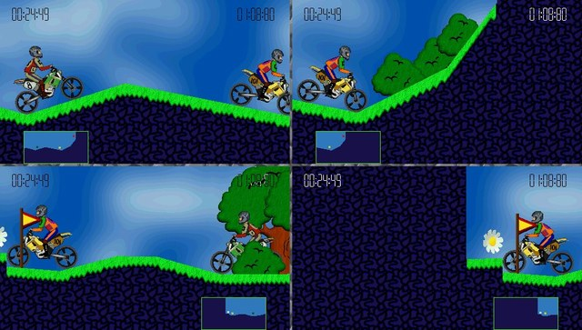
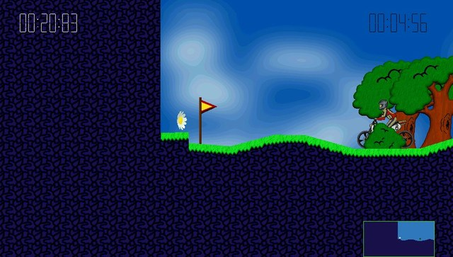
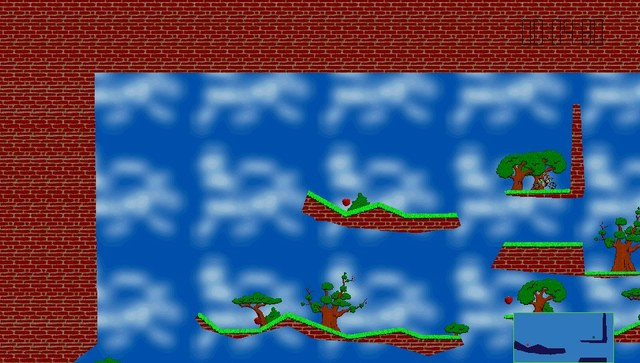
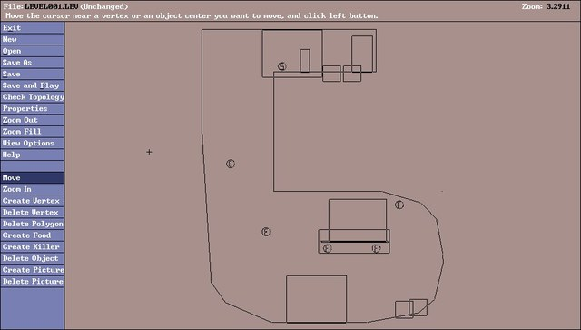
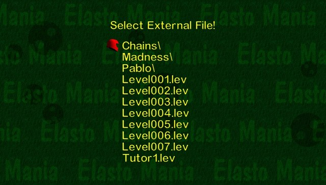

# Elasto Mania for PS Vita (unofficial port)

This is a PS Vita port of the **Elasto Mania (2000) source code** released by the
Elasto Mania Team at https://github.com/elastomania/elma-classic. The game logic
and level editor are the original code. The Windows platform layer (DirectDraw,
DirectInput, DirectSound, Win32) has been replaced with a Vita one.

It contains **no game assets**. You need the data files from your own copy
of Elasto Mania, shareware 1.11a or registered 1.11a.

**Download:** get `elma.vpk` from the [Releases](https://github.com/bosshunter/elma-vita/releases) page and install it with VitaShell, then copy the game data (see [Installing the game data](#installing-the-game-data)).

## Screenshots

<table>
  <tr>
    <td></td>
    <td></td>
  </tr>
  <tr>
    <td align="center">4 player split screen</td>
    <td align="center">Native 960x544 gameplay</td>
  </tr>
  <tr>
    <td></td>
    <td></td>
  </tr>
  <tr>
    <td align="center">Zoomed out</td>
    <td align="center">Level editor at 960x544</td>
  </tr>
  <tr>
    <td></td>
    <td></td>
  </tr>
  <tr>
    <td align="center">External levels with folders</td>
    <td></td>
  </tr>
</table>

## Building

You need [VitaSDK](https://vitasdk.org) with its default packages (vita2d, zlib,
libpng, libjpeg-turbo, freetype). `vdpm` installs all of these.

```sh
export VITASDK=/usr/local/vitasdk      # wherever your SDK is
mkdir build && cd build
cmake ..
make
```

The output is `build/elma.vpk`. Install it with VitaShell.

## Installing the game data

Copy everything from your Windows Elasto Mania folder (`elma.res`, `state.dat`, 
and the `lev`, `lgr` and `rec` folders) to:

```
ux0:data/elma/
```

The data folder is set in `CMakeLists.txt` (`ELMA_DATA_DIR`). The same build
runs both the **shareware** and the **registered** version: at start-up it
looks at `elma.res` and behaves like the matching PC version (19 or 55 levels,
the shareware editor limits, the shareware end screen, which `state.dat` and
level files it accepts). Your `state.dat` (players, best times, key
bindings) can be copied across as well. As on the PC, the registered version
accepts a shareware `state.dat`, but not the other way round. The default key
codes were chosen so that Windows bindings work unchanged.

In the shareware version, a level saved by the registered version cannot be
played, replayed or opened in the editor (as on the PC). Instead of closing
the game, it says so and goes back: to the level list, the replay list, or an
empty level in the editor. Locked levels cannot be edited in the shareware
version either; the registered version lets you edit them after a warning.

## Screen

- **Gameplay** renders natively at **960x544**. You see more of the level, and
  nothing is stretched. L and R zoom out and in (see below).
- **Menus** are drawn natively at **960x544**, without stretching. The
  background covers the whole screen and the bouncing balls use the real
  screen edges. The menu items keep their original layout in the middle. The
  3P/4P results and best-times screens use the full width.
- **Level editor** is drawn natively at **960x544** too: the drawing area
  uses the whole screen. Its dialogs (Open, Save As, pictures, level
  properties…) keep their original layout and open in the middle of the
  screen. The touch screen and the cursor map 1:1.

## Controls

**Menus**

| Vita | Action |
|---|---|
| D-Pad Up / Down | Move through the entries |
| D-Pad Left / Right | Left / Right (where a menu uses them) |
| Cross or Start | Select (Enter) |
| Circle | Back (Esc) |
| R + D-Pad Up / Down | Page up / page down (level lists) |
| Square | Backspace in text fields |

**In game** (these are the default bindings and can be changed in Options → Customize controls)

| Vita | Action | Windows key |
|---|---|---|
| Cross | Accelerate | Up |
| Square | Brake | Down |
| D-Pad Right | Rotate clockwise | Right |
| D-Pad Left | Rotate anticlockwise | Left |
| Circle | Turn around | Space |
| Select | Back to the menu | Esc |
| D-Pad Down | Show / hide minimap | T |
| D-Pad Up | Show / hide timer | V |
| L | Zoom out | - |
| R | Zoom in | = |
| Triangle | Screenshot | I |

Esc is split on purpose: Circle in menus, Select in game, because Circle turns
the bike around.

**External controllers (ds34vita)**

With the [ds34vita](https://github.com/MERLev/ds34vita) plugin (and
[MiniVitaTV](https://github.com/TheOfficialFloW/MiniVitaTV)), up to four
DualShock 3/4 controllers can be connected. Every button is named after its
pad: **Pad 1** is the Vita itself, the controllers are **Pad 2, 3, 4…**.

- Every button on every pad has its own binding, so any player can use any mix
  of the Vita's own buttons and pad buttons. Two players can still share the
  Vita itself, for example one on D-pad + L and the other on the face buttons
  + R.
- Default bindings: player A on Pad 1, and players B, C and D on Pads 2, 3
  and 4, each with the same layout (Cross accelerate, Square brake,
  D-pad Left/Right rotate, Circle turn, D-pad Up/Down toggles). *Reset all
  controls to default* restores these.
- In menus, any pad can navigate: D-pad, Cross/Start = Enter, Circle = Back,
  R1/R2 + Up/Down = page.
- In game, any pad's Select returns to the menu and its Start resets the zoom.
- A pad's left stick also works as its D-pad.

**Level editor**

| Vita | Action |
|---|---|
| Left stick, or touch the screen | Move the mouse cursor |
| Cross | Left mouse button |
| Circle | Right mouse button and Esc (cancel) |
| Start | Enter |
| Square | Backspace |
| Triangle | Space |
| D-Pad | Arrow keys |

**Text entry.** The Vita on-screen keyboard opens for player names, external
file names, and in the editor for Save As file names, the level name,
distances and clipping (U / G / S). The text is passed to the game's own
input code, so the original length and character rules still apply. For Save
As, the keyboard fills in the name and you then click **SAVE** or **SAVE
LOCKED** (or press Start).

## Players C and D

*Options → Play mode* cycles Single Player → 2P → 3P → 4P Multiplayer. In 3P
and 4P, *Player C* / *Player D* entries choose those players' profiles, and
*Customize controls* lists *Customize Player C* / *D*. Players C and D, their
controls and the player count are stored in `state34.dat`, so `state.dat`
keeps the original format and still works with the PC game.

**Split screen**

| Players | Layout |
|---|---|
| 2 | A on top, B below (as the original) |
| 3 | A on top in the middle; B bottom left, C bottom right (all three the same size) |
| 4 | A top left, B top right; C bottom left, D bottom right |

Each player sees every other player's bike, and all of them on the navigator
(minimap). There are only two bike designs in the `.lgr` files, so A and C ride
the first one and B and D the second; *Swap Bikes* swaps them as before.

**Zoom**: hold *Zoom In* (R) or *Zoom Out* (L) while playing or watching a
replay. It works in every play mode and applies to all views. The range is
from 0.3x (much more of the level; slower, see below) to 2x; letting go near 1x snaps back to the
original scale. The navigator and the timer keep their size. *Inc. / Dec.
Screen Size* are still in Options → Customize controls, unassigned by
default. The zoom keys are saved in `state34.dat` (`state.dat` stays
readable by the PC game). The first time this version starts, if L / R are
still on the screen size (the old defaults), they are moved to zoom.
The zoom stays the same from level to level and is saved in `state34.dat`,
so it is still there the next time you start the game. **Start** during a
level or replay sets it back to 1x. Zooming far out is slower,
because the game draws on the CPU (at 0.3x a full screen view has about 11
times as many pixels to draw).

**Saving**: settings, controls, players and progress are saved every time
the main menu comes back and after every level, not only when quitting
through the menu, so closing the game with the PS button loses nothing.

**Screen size in split screen (2P–4P)**: there are two extra steps above the
original biggest size. *Inc. Screen Size* at full size makes the gap between
the views thinner and then removes it; *Dec. Screen Size* brings the gap back
and then shrinks the views as before. A game starts with the thin gap. (These
two keys are unassigned by default; set them in Customize controls.)

| Step (Inc. → Dec.) | Views |
|---|---|
| 1 | Full size, no gap |
| 2 | Full size, thin gap (default) |
| 3 | Full size, the original gap |
| 4 and on | Smaller views, as in the original |

*Toggle Show/Hide* (in *Customize controls*): in 2P it works as in the
original. In 3P/4P each player hides or shows their own view, and the views
still shown share the screen (one = full screen, two = top / bottom, three =
the same-size triangle as 3P). If every view is hidden, all of them come back.

As in 2P, the level ends when any player touches the flower, or when everyone
has died. The apples of all players count together. Every player's engine is
heard. With 3 or 4 engines running they are turned down to the loudness of
two, so they don't distort; 1P/2P sound is unchanged.

**Flag Tag with 3–4 players**: one player holds the flag and collects time.
Touching the holder takes the flag; after a pass, the two must separate before
it can pass again. If the holder dies, the flag goes to the player nearest to
where they died. A player killed for good (by a killer object) never receives
the flag, and loses it if they had it.
The starting holder rotates through the players from game to game.

**Replays**: 1–2 player games are saved as `.rec` (unchanged, PC compatible),
3–4 player games as `.rc4`. The replay list shows both; `.rc4` files are
listed with their extension.

**Best times**: 3P and 4P have their own top-ten tables, for internal and
external levels, kept in `state34.dat` (the `.lev` files and `state.dat`
keep the original format). The in-game best time shows the 3P/4P record.
*Best Times* in the main menu has *3 Player Times* and *4 Player Times*
next to the original two, and *Best times* after a 3P/4P level opens the
table for that level. The times of an external level belong to that exact
version of it; once the level is changed in the editor, its table starts
again, like the times stored in the `.lev` file.

**Results**: after a 3P/4P level, the screen lists every player with their
name, apples and (in Flag Tag) flag time across the full width.

## Changes from the original game

- Shareware or registered is decided at start-up from `elma.res`, instead of
  when compiling (`SARVARI` is no longer used).
- Menus and the level editor drawn natively at 960x544 instead of stretched.
- External controllers (ds34vita), players C and D, 1P–4P play modes,
  3P/4P split screen, Flag Tag, replays (`.rc4`) and best times.
- Subfolder navigation in the External level menu and in the editor (folders and 
  level file names should have up to 8 characters and no spaces).
- The external file list has no file cap (it is also sorted with `qsort`
  now, so very large folders open quickly).
- Wrap-around and auto-scrolling in all menus and in the editor's level list. Up on the 
  first entry goes to the last, and Down on the last goes to the first.
- 960x544 gameplay view, Vita controls, Vita on-screen keyboard.
- The left stick works as the D-pad.
- Square erases a binding.
- Added zoom in and out when playing a level. Start resets the zoom.
- The touch screen works as a tablet in the editor.
- Locked levels can be opened in the editor after a warning (registered
  version only), and a normal Save writes them unlocked.

Every change to the original source files is marked with a `(port)` comment.
To see all of them, compare `src/` with the original source at
https://github.com/elastomania/elma-classic.

## Source layout

| Path | Contents |
|---|---|
| `src/` | The original source with lowercase file names, forward-slash includes and the changes above |
| `platform/` | New Vita platform layer. `vita_platform.cpp` covers video (vita2d, 8-bit palettized texture), input, mouse emulation, timer, sound output (sceAudioOut), the on-screen keyboard and `main()`. `vita_hhigh.cpp` is the original sound mixer, with four engine voices |
| `compat/` | Small shims for Watcom/MSVC runtime functions and DOS-style paths |
| `build_units.txt` | The files that make up the game (the Windows build without its DOS/Windows platform code and stale copies) |
| `sce_sys/` | LiveArea images (icon, background, start gate) |
| `screenshots/` | The pictures in this README |

## Known limitations

- **Replays recorded on PC may play back differently.** The original ran its
  physics on the x87 FPU (80-bit) and the Vita uses 64-bit doubles. Replays
  recorded on the Vita play back correctly on the Vita.
- The editor's other keyboard shortcuts have no buttons. Everything can be
  reached with the cursor.

## License

The game source is © the Elasto Mania Team and is used under its dual license
(see `LICENSE.md`): **Creative Commons Attribution-NonCommercial-ShareAlike 4.0**
plus the additional terms in its preamble. This port is an adaptation and is
released under the same license. It is non-commercial, it may not be used for
cheats or competitive advantage, and "Elasto Mania" is a trademark of its
owners. This port is not affiliated with or endorsed by them. The original
README is kept as `ORIGINAL_README.md`.
